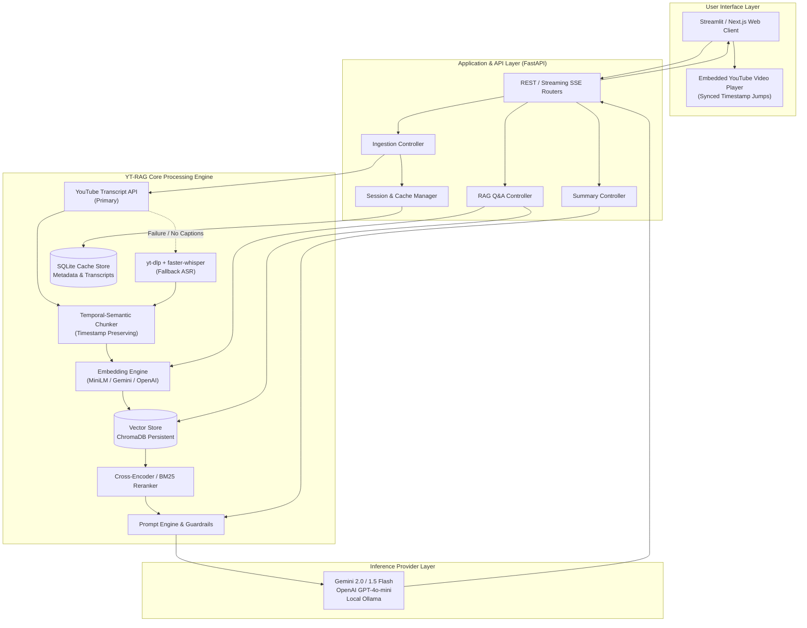
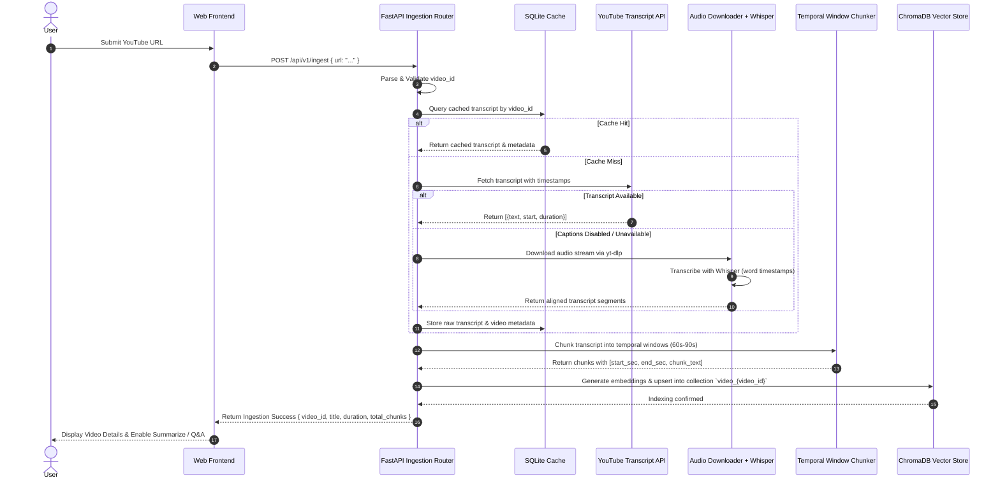
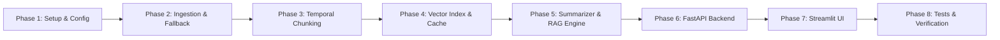

# YT-RAG: Production-Quality YouTube Video Summarizer & Q&A System
## Architecture Design, Requirements Document & Execution Roadmap

---

## 1. Executive Summary & Project Goals

**YT-RAG** is an enterprise-grade Retrieval-Augmented Generation (RAG) system engineered to ingest YouTube video content, extract and synthesize transcripts with exact temporal grounding, generate multifaceted summaries, and provide conversational question-answering with verifiable, click-to-play timestamp citations.

### Primary Engineering Objectives:
1. **Temporal Grounding & Precision**: Every generated claim or Q&A response must cite verifiable video timestamps (`mm:ss` format) linked directly to the video source.
2. **Resilient Ingestion**: Dual-tier transcript acquisition—primary extraction via YouTube's official transcript API with automatic fallback to audio extraction and Whisper speech-to-text when captions are disabled or unavailable.
3. **High Retrieval Precision**: Temporal-semantic window chunking and hybrid dense/lexical retrieval to avoid context truncation and hallucination.
4. **Cost & Latency Efficiency**: Hash-based tiered caching (SQLite/File) for transcripts, embeddings, and summaries to prevent redundant API calls and re-indexing.
5. **Production Modularity**: Clean architectural boundary between core domain logic, vector store abstraction, LLM providers (Google Gemini / OpenAI / Groq / Local), FastAPI REST endpoints, and an interactive UI.

---

## 2. Requirements Specification

### 2.1 Functional Requirements (FR)

| ID | Feature | Specification |
|:---|:---|:---|
| **FR-01** | **URL Parsing & Validation** | Support standard YouTube URLs (`youtube.com/watch?v=...`), short links (`youtu.be/...`), Shorts, and timestamped query params. Extract canonical `video_id`. |
| **FR-02** | **Transcript Extraction** | Ingest manual and auto-generated transcripts with timing metadata (`start`, `duration`, `text`) supporting multi-language selection (defaulting to English with auto-translation if requested). |
| **FR-03** | **Audio Fallback Ingestion** | When closed captions are missing, stream audio via `yt-dlp` into an asynchronous Whisper model (`faster-whisper` local or cloud API) to produce timestamped transcription chunks. |
| **FR-04** | **Temporal Chunking** | Segment transcripts into coherent contextual windows (e.g., 60–90 seconds or 250–400 tokens) with sliding overlap (15–20s) while preserving exact `[start_timestamp, end_timestamp]` metadata. |
| **FR-05** | **Multi-Modal Summarization** | Provide 4 distinct summarization modes:<br>1. *Executive TL;DR* (3-5 bullet core takeaway)<br>2. *Detailed Technical Summary* (structured markdown with key concepts)<br>3. *Timestamped Chapter / Topic Agenda* (chronological outline)<br>4. *Action Items & Highlights* |
| **FR-06** | **Timestamped Q&A (RAG)** | Answer ad-hoc queries over the video transcript. Each response must cite source intervals (e.g., `[04:12 - 04:45]`) and provide jump links (`https://youtu.be/<id>?t=252`). |
| **FR-07** | **Anti-Hallucination Guardrails** | Enforce strict contextual grounding. If an answer cannot be deduced from the retrieved video context, the model explicitly declares absence of information rather than confabulating. |
| **FR-08** | **Multi-turn Conversational Memory** | Maintain session context for follow-up questions with query contextualization (reformulating ambiguous pronouns using chat history). |
| **FR-09** | **Transcript & Embedding Caching** | Cache extracted transcripts and vector collections by `video_id` in persistent storage. Instant reload for previously ingested videos without incurring token/compute costs. |
| **FR-10** | **Export Capabilities** | Export summaries, chapter breakdowns, and Q&A chat transcripts as Markdown, PDF, or JSON. |

### 2.2 Non-Functional Requirements (NFR)

- **Latency**:
  - Ingestion & indexing for a 20-minute video: `< 5s` (when captions exist).
  - Summarization generation: `< 6s` using streaming LLM completions.
  - RAG Query Latency: `< 1.8s` time-to-first-token (TTFT).
- **Scalability & Concurrency**: Asynchronous I/O (`asyncio`, `httpx`, FastAPI) ensuring non-blocking vector searches and streaming responses.
- **Reliability & Resilience**: Circuit breakers for external APIs, graceful rate-limit retries with exponential backoff.
- **Portability**: Pluggable vector store (ChromaDB default, Qdrant/FAISS ready) and pluggable LLM interface (Gemini / OpenAI / Groq / Ollama).
- **Security & Privacy**: Zero persistence of sensitive API keys on disk; configured via environment variables and `.env` schemas validated by Pydantic.

---

## 3. System Architecture & Flow Diagrams

### 3.1 High-Level Component Architecture



---

### 3.2 Ingestion & Indexing Sequence Flow



---

### 3.3 Query & Timestamped Retrieval Flow

```mermaid
sequenceDiagram
    autonumber
    actor User
    participant UI as Chat Interface
    participant API as RAG Controller
    participant VDB as ChromaDB
    participant Rerank as Reranker Engine
    participant LLM as Inference LLM

    User->>UI: Ask: "What did the speaker say about transformer attention?"
    UI->>API: POST /api/v1/chat/query { video_id, question, history }
    API->>API: Contextualize question (resolve coreferences)
    API->>VDB: Query dense embeddings (Top-K = 10)
    VDB-->>API: Return 10 candidate chunks with temporal metadata
    API->>Rerank: Rerank candidates against query (Top-N = 4)
    Rerank-->>API: Return most relevant temporal segments
    API->>LLM: Formulate prompt with strict grounding constraints & context
    LLM-->>API: Stream tokens: Answer with [MM:SS] citation anchors
    API-->>UI: Stream answer tokens & formatted timestamp links
    UI-->>User: Render interactive response; clicking [04:15] seeks YouTube player
```

---

## 4. Deep-Dive Component Technical Design

### 4.1 Ingestion & Audio Fallback Mechanism
1. **Primary Route**: `youtube-transcript-api`
   - Attempts to retrieve manually uploaded subtitles first (`en`, `en-US`, etc.).
   - Falls back to automatic speech recognition (ASR) transcripts generated by YouTube.
   - Preserves granular timestamps down to tenths of a second.
2. **Secondary Fallback Route**: `yt-dlp` + `faster-whisper`
   - Triggered when transcripts are disabled, restricted, or unavailable in the target language.
   - Extracts low-bitrate audio stream (`m4a` / `mp3`) in memory or temporary scratch space.
   - Passes to `faster-whisper` (`base` or `small` model on CPU/CUDA) using batched inference with VAD (Voice Activity Detection) filter.
   - Generates normalized segments formatted identical to the YouTube Transcript API schema:
     `{"text": str, "start": float, "duration": float}`.

### 4.2 Temporal-Semantic Chunking Strategy
Standard text-splitters (e.g. RecursiveCharacterTextSplitter) break arbitrary sentences and dissociate text from timing data. 
**YT-RAG implements a custom Temporal Window Chunker**:
- **Aggregation Window**: Target window of 60 to 90 seconds (or ~250–350 tokens).
- **Stride / Overlap**: 15–20 seconds overlap between successive chunks to avoid boundary information loss.
- **Metadata Preservation**:
  ```json
  {
    "chunk_id": "vid_abc123_chunk_004",
    "video_id": "abc123",
    "start_time": 182.4,
    "end_time": 254.1,
    "timestamp_display": "03:02 - 04:14",
    "youtube_url": "https://youtu.be/abc123?t=182",
    "text": "...contextual transcript content..."
  }
  ```

### 4.3 Vector Indexing, Hybrid Search & Reranking
- **Vector Database**: `ChromaDB` initialized in persistent directory mode with isolated collections per video or tenant collection with `video_id` metadata filter.
- **Embedding Provider**: Multi-model abstraction (`sentence-transformers/all-MiniLM-L6-v2` locally with zero API cost, or cloud models `text-embedding-3-small` / Gemini `text-embedding-004`).
- **Hybrid Retrieval**:
  1. Dense vector similarity search retrieves Top-10 candidates.
  2. Fast Cross-Encoder / FlashRank reranks candidates to select Top-3 to 5 highest fidelity context snippets, drastically reducing prompt token waste and suppressing irrelevant transcript noise.

### 4.4 Summarization Architecture (Map-Reduce & Hierarchical)
- Videos vary from 3 minutes to 3 hours. A single-shot prompt fails on long transcripts due to context limits or attention degradation ("lost in the middle").
- **Adaptive Strategy**:
  - **Short Videos (< 20 mins)**: Single-shot contextual prompt with structured output schema.
  - **Medium/Long Videos (> 20 mins)**: Hierarchical Map-Reduce:
    - *Map*: Summarize each 10-minute segment into key topics and timestamped takeaways.
    - *Reduce*: Synthesize segment summaries into an integrated executive briefing, topic agenda, and critical takeaways.

### 4.5 Q&A Prompt Engineering & Strict Citation Guardrails
- **Prompt Structure**:
  - Context blocks injected with explicit timestamp tags: `[START: 05:22] <chunk text> [END: 06:15]`.
  - Negative constraint: *"You are an objective AI assistant analyzing a specific YouTube video transcript. Base your answer STRICTLY on the provided transcript excerpt. If the answer cannot be determined from the excerpts, reply: 'This video does not mention or cover this topic.' Do NOT guess or hallucinate outside the provided context."*
  - Formatting directive: *"For every assertion or quote, you must append the timestamp in format `[MM:SS](URL_WITH_TIMESTAMP)`."*

---

## 5. Technology Stack Recommendations

| Component | Selected Technology | Alternative Considered | Rationale |
|:---|:---|:---|:---|
| **Language** | Python 3.12+ | Python 3.11 | High performance, native typing improvements, active ecosystem support. |
| **Package Manager** | `uv` | `poetry` / `pip` | 10x-100x faster dependency resolution and virtualenv handling. |
| **Web / API Framework** | `FastAPI` + `Pydantic v2` | Flask / Django | Asynchronous endpoints, native OpenAPI schema generation, fast validation. |
| **Transcript Fetching**| `youtube-transcript-api` + `yt-dlp` | `pytube` (broken/unmaintained) | High reliability, active maintenance, robust proxy support. |
| **Speech-to-Text** | `faster-whisper` (CTranslate2) | OpenAI Whisper API | High speed, low memory footprint, runs locally or offline without external API cost. |
| **Vector Store** | `ChromaDB` | `Qdrant` / `FAISS` | Embedded, zero-infrastructure setup, persistent SQLite backend, easy migration. |
| **Embeddings** | `sentence-transformers` / Gemini / OpenAI | HuggingFace Inference API | Modular interface supporting both 100% free offline and cloud models. |
| **LLM Inference** | Google Gemini 2.0/1.5 & OpenAI GPT-4o-mini | Claude 3.5 Sonnet / Ollama | Gemini provides 1M-2M context window + low cost; OpenAI provides widespread compatibility. |
| **UI Framework** | `React` + `Vite` + `TailwindCSS` | Next.js / Streamlit | Modern reactive SPA, direct YouTube IFrame API control, silky timestamp seeking, chat streaming. |
| **Caching Layer** | `SQLite3` + Local Cache | Redis | Zero setup overhead, persistent single-file storage, ACID compliant. |

---

## 6. Target Project File Structure

```
c:\Users\Ayushi\Projects\RAG\
├── .env.example                  # Environment variable template
├── .gitignore                    # Standard Python, cache, and DB ignore
├── pyproject.toml                # uv/pip dependencies & build metadata
├── README.md                     # Documentation, setup & API reference
├── data/
│   ├── cache/                    # SQLite database for cached transcripts
│   └── vector_store/             # ChromaDB persistent collections
├── src/
│   ├── __init__.py
│   ├── config.py                 # Pydantic Settings (API keys, model selection)
│   ├── core/
│   │   ├── __init__.py
│   │   ├── exceptions.py         # Custom domain exceptions
│   │   ├── logger.py             # Structured logging configuration
│   └── utils.py                  # Timestamp conversion, URL parsing
│   ├── ingestion/
│   │   ├── __init__.py
│   │   ├── youtube.py            # YouTube transcript extractor
│   │   ├── audio_transcriber.py  # yt-dlp + whisper fallback engine
│   │   └── metadata.py           # Video metadata & thumbnail parser
│   ├── processing/
│   │   ├── __init__.py
│   │   ├── chunker.py            # Temporal window chunking engine
│   │   └── cleaner.py            # Text normalization & sound effect removal
│   ├── storage/
│   │   ├── __init__.py
│   │   ├── cache.py              # SQLite transcript & summary cache
│   │   └── vector_store.py       # ChromaDB wrapper with hybrid search
│   ├── rag/
│   │   ├── __init__.py
│   │   ├── embeddings.py         # Embedding model abstraction
│   │   ├── llm_factory.py        # LLM client provider (Gemini / OpenAI / Groq)
│   │   ├── prompts.py            # Grounded system prompts & few-shots
│   │   ├── summarizer.py         # Multi-mode & hierarchical summarizer
│   │   └── qa_chain.py           # Conversational RAG engine with citations
│   ├── api/
│   │   ├── __init__.py
│   │   ├── app.py                # FastAPI app initialization
│   │   ├── routes.py             # Ingestion, Summary, and Q&A endpoints
│   │   └── schemas.py            # Request/Response Pydantic schemas
│   └── ui/
│       ├── __init__.py
│       └── app.py                # Interactive Streamlit frontend with video player
└── tests/
    ├── __init__.py
    ├── test_url_parser.py        # URL normalization tests
    ├── test_chunker.py           # Temporal window validation tests
    ├── test_ingestion.py         # Transcript fetching tests
    └── test_rag.py               # Grounding and citation tests
```

---

## 7. Step-by-Step Implementation Roadmap



### Phase 1: Environment & Project Foundation
- Initialize project with `uv`.
- Configure `pyproject.toml` with strict dependency pinning:
  - `fastapi`, `uvicorn`, `pydantic-settings`, `youtube-transcript-api`, `yt-dlp`, `chromadb`, `sentence-transformers`, `google-genai`, `openai`, `streamlit`, `pytest`.
- Implement `src/config.py` using `pydantic-settings` to parse `.env` for API keys (`GEMINI_API_KEY`, `OPENAI_API_KEY`, etc.) and system defaults.
- Implement structured logging and centralized error handling.

### Phase 2: Ingestion & Audio Fallback Engine
- Implement `src/core/utils.py` for YouTube URL parsing (regex for standard, short, live, embed links) and timestamp conversions (`seconds_to_hms`, `hms_to_seconds`).
- Implement `src/ingestion/youtube.py` with `youtube-transcript-api` to fetch manual or auto-generated transcripts with error isolation (transcripts disabled, IP blocked, video private).
- Implement `src/ingestion/audio_transcriber.py` with `yt-dlp` stream extraction and `faster-whisper` fallback.
- Implement `src/ingestion/metadata.py` to fetch video title, author, thumbnail, and duration.

### Phase 3: Temporal-Semantic Chunking Engine
- Implement `src/processing/cleaner.py` to strip subtitle artifacts, music notes (`[Music]`, `[Applause]`), and duplicate lines.
- Implement `src/processing/chunker.py` to aggregate raw transcript fragments into 60–90 second semantic chunks with 15–20 second overlaps, tracking start/end timestamps and formatted URLs.

### Phase 4: Vector Storage & Caching Layer
- Implement `src/storage/cache.py` SQLite database to cache raw transcripts, chunked data, and video metadata keyed on `video_id`.
- Implement `src/rag/embeddings.py` supporting both local (`sentence-transformers/all-MiniLM-L6-v2`) and cloud embeddings.
- Implement `src/storage/vector_store.py` wrapping `chromadb.PersistentClient` with collection-per-video or filtered collection retrieval.

### Phase 5: Summarization & RAG Q&A Engine
- Implement `src/rag/llm_factory.py` providing a unified client for Gemini and OpenAI.
- Implement `src/rag/prompts.py` containing:
  - Executive TL;DR prompt
  - Structured Key Chapters prompt
  - Anti-hallucination Grounded Q&A prompt with timestamp citation requirements
- Implement `src/rag/summarizer.py` supporting single-shot and Map-Reduce summaries.
- Implement `src/rag/qa_chain.py` with conversational history, coreference resolution, and citation synthesis.

### Phase 6: Application Layer & API
- Implement `src/api/schemas.py` with typed Pydantic models for `/ingest`, `/summarize`, `/query`, and `/history`.
- Implement `src/api/routes.py` with streaming endpoints (Server-Sent Events) for token-by-token UI updates.
- Implement `src/api/app.py` with CORS, exception handlers, and health probe (`/healthz`).

### Phase 7: Production React Frontend (Vite + TailwindCSS)
- Initialize Vite + React + TypeScript frontend in `frontend/`.
- Embedded YouTube Player with bidirectional sync:
  - YouTube IFrame API integration to listen to playback state and programmatic `seekTo(seconds, true)`.
  - Ingestion panel with URL validation, video metadata card, and duration.
  - Multi-tab summary dashboard:
    - Executive TL;DR
    - Key Chapter breakdown with clickable time anchors
    - Technical takeaways & action items
  - Conversational RAG Q&A interface with streaming answers, timestamp badge citations that instantly seek the embedded video on click, and chat history.
  - Export tools for summaries and chat transcripts (Markdown / JSON).

### Phase 8: Verification & Automated Tests
- Unit tests for URL normalization and regex patterns.
- Unit tests for chunker timing continuity and overlap boundaries.
- Mock integration tests for transcript retrieval and RAG pipeline.
- End-to-end smoke test with a real public YouTube video.

---

## 8. Risk Assessment & Mitigations

| Risk / Failure Mode | Likelihood | Impact | Mitigation Strategy |
|:---|:---:|:---:|:---|
| **YouTube blocks IP / Captcha on transcripts** | Medium | High | Support proxy configuration in `youtube-transcript-api`; immediate fallback to `yt-dlp` or user-provided manual transcript upload. |
| **Video lacks captions / audio-only** | Medium | Medium | Automated fallback to `faster-whisper` speech-to-text. |
| **LLM Hallucinates timestamps** | Medium | High | Hard constraint in system prompt to only quote timestamps directly present in context chunks; post-generation validation regex checking that cited timestamps exist in retrieved chunks. |
| **Long video exceeds context window** | Low | Medium | Automatic hierarchical Map-Reduce summarization for videos exceeding 20 minutes. |
| **High latency on re-visiting video** | High | Low | SQLite-based persistent transcript and summary caching. Ingestion is executed only once per video. |

---

## 9. Next Steps & Execution Plan

Upon user confirmation of this specification:
1. Initialize the project workspace and dependency files (`pyproject.toml`, `.env.example`).
2. Build the ingestion engine with dual-tier fallback and temporal chunker.
3. Build the vector store and RAG pipeline with timestamp citation enforcement.
4. Build the FastAPI service and interactive Streamlit UI.
5. Verify end-to-end functionality with comprehensive tests.

